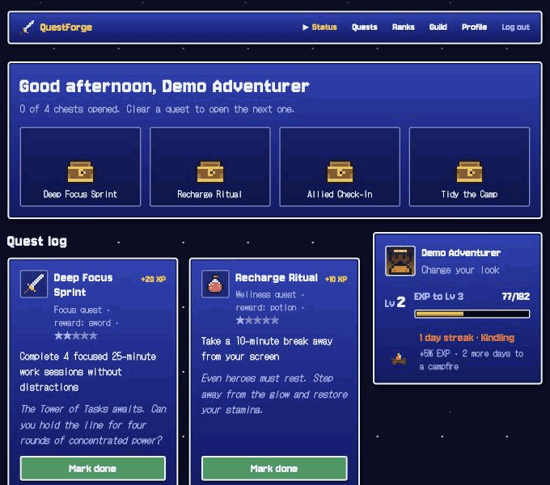
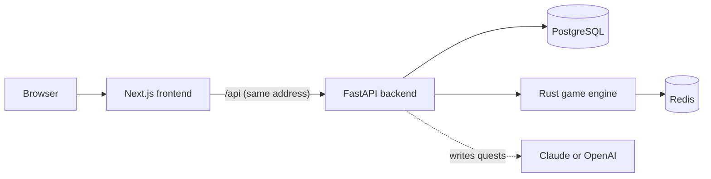

# ⚔️ QuestForge

A cozy retro RPG that turns small daily tasks into quests. An AI game master posts a few quests each morning (a focus sprint, a stretch break, a message to a friend), and finishing them earns XP, opens treasure chests and keeps your campfire burning.




## Try it

**Live demo:** coming soon. Click **Try the demo** on the home page to play without signing up.

**Run it locally** (needs Docker):

```bash
git clone https://github.com/TabascoSlim/questforge.git
cd questforge
cp .env.example .env
docker compose up --build
```

Then open http://localhost:3000 and click **Try the demo**. An Anthropic or OpenAI API key in `.env` lets the game master write fresh quests; without one, it uses a built-in set.

## What it does

- **An AI game master.** Hazel the owl writes 3–5 daily quests based on the categories you pick and how your recent days went.
- **XP, levels and streaks.** Every finished quest earns XP. Coming back day after day adds a streak bonus of up to +100%.
- **A fire that grows with your streak.** It starts as kindling, becomes a campfire at 3 days and a bonfire at 7.
- **Guilds.** Join a small group with a short invite code (like `MILL-2048`) and compete on a shared leaderboard.
- **A pixel avatar wardrobe.** Pick your skin, hair, hair color, face, outfit and hat from dropdowns.

## Screenshots

| Status | Quests |
|---|---|
|  |  |
| **Ranks** | **Wardrobe** |
|  |  |

## How it fits together



| Piece | What it does | Why it's separate |
|---|---|---|
| **Next.js** | The pixel-art interface | Forwards every `/api` call to the backend, so the browser only ever talks to one address |
| **FastAPI** | Accounts, quests, guilds, the AI game master | Python is the natural home for the LLM calls and data models |
| **Rust engine** | XP math, levels, streaks, leaderboards | Game rules live in one fast service that every other piece trusts |
| **PostgreSQL** | Users, quests, guilds, activity history | Data that needs relations and history |
| **Redis** | XP totals, streaks, ranked leaderboards | Sorted sets make leaderboards instant |

All five run with one `docker compose up`, with health checks so each service waits for the ones it depends on.

## How I built this with AI

I built QuestForge with **Claude** as my coding partner. QuestForge started as an unfinished prototype in my projects folder that didn't run end to end. I wanted to take it from there to something an employer could open and play.

**How we split the work.** I set the direction and made the calls: what the game should feel like, which features mattered for a demo, what looked wrong, and when something was good enough. Claude wrote and debugged most of the code. I tested every change myself by running the app and playing it in the browser, then reported back what I saw. Most of the work was that loop: describe what I wanted, review the result, push back on what was off.

**Real problems we hit and how they got solved:**

1. **The frontend wouldn't build in Docker.** `npm ci` failed because the lockfile didn't match `package.json`. We regenerated it inside the same Node 20 image Docker uses, so both sides agreed.
2. **The Rust container started and immediately exited.** The Dockerfile pre-builds a placeholder `main.rs` to cache dependencies, and Cargo kept reusing that empty build instead of the real code. Touching the real source before the final build fixed it.
3. **The browser blocked calls between ports.** The frontend on port 3000 couldn't call the backend on port 8000. Instead of loosening security settings, we made Next.js forward `/api` requests to the backend, so the browser only ever talks to one address.
4. **Logins broke on a library update.** `passlib` doesn't work with `bcrypt` 5, so password hashing crashed. We dropped `passlib` and called `bcrypt` directly, including its 72-byte password limit.
5. **The guild leaderboard left people out.** Anyone who joined a guild after earning XP didn't appear in its rankings, because only XP earned after joining was counted. The guild board now ranks current members by their total XP, so joining and leaving update it right away.

**Design changes along the way.** My first idea was a cozy Stardew Valley look, but in practice it felt too bright, so I switched to a classic Final Fantasy-style menu look: deep blue windows, white borders, a ▶ cursor. The first pixel font was hard to read (the 2 and 8 blurred together, and C looked like G), so Claude built a side-by-side test page of seven free pixel fonts with those exact trouble spots. I picked **Jersey 10** for headings and **DotGothic16** for body text.

## Honest limits and what's next

- **Quests run on the honor system.** "Mark done" trusts you. Ways to verify them would include a minimum time before a quest can be finished, an in-app focus timer, integrations (a calendar or step counter), short AI check-ins about what you did, or guildmates vouching for each other.
- **This is a demo, not a finished product.** It covers one complete loop (quests → XP → levels → streaks → guilds) rather than every feature a real app would need.

## Project layout

```
questforge/
├── frontend/       Next.js app: pages, pixel sprites, avatar builder
├── backend/        FastAPI: auth, quests, guilds, AI game master, demo world
├── game-engine/    Rust (axum): XP, levels, streaks, leaderboards
├── game-wasm/      Optional WebAssembly build of the XP math
└── docker-compose.yml
```

## Credits

- Fonts: [Jersey 10](https://fonts.google.com/specimen/Jersey+10) and [DotGothic16](https://fonts.google.com/specimen/DotGothic16), both under the SIL Open Font License.
- Pixel sprites (items, chests, fires, avatars) were drawn in code for this project.
